 

**[Quick start](#-quick-start)** &nbsp;•&nbsp; **[What's new](#-whats-new)** &nbsp;•&nbsp; **[AI features](#-ai-features-optional-free)** &nbsp;•&nbsp; **[Themes](#-themes--liquid-glass)** &nbsp;•&nbsp; **[Live Share](#-live-share-one-way-no-server)** &nbsp;•&nbsp; **[FAQ](#-troubleshooting--faq)**

## ✨ Why NovaBoard

NovaBoard is a smartboard-style whiteboard and presentation workspace that runs in your browser from **a single HTML file**. Open it, draw, teach, present. Nothing to install, nothing to sign up for.

| 🖊️ Teach and draw | 📑 Bring your slides | 🤖 Create with AI | 🔒 Stay private |
| :--- | :--- | :--- | :--- |
| Four pens, shapes in 2D and 3D, multi-page boards, widgets and 11 smart classroom tools | Import PDF and PowerPoint (`.pptx`), annotate, export back to PDF | Free AI chat, designed slide decks and image generation, with your own provider if you like | Everything stays on your device. No account, no uploads, no tracking |

## 🚀 Quick start

**Open it.** Download `index.html` and double-click it in a modern browser (Chrome, Edge, Firefox or Safari). The web version loads its libraries from public CDNs, so it needs an internet connection. For a fully offline experience, use the [desktop app](README-DESKTOP.md).

**Host it.** Upload `index.html` to any static host (GitHub Pages, Netlify, Cloudflare Pages). On GitHub Pages: *Settings → Pages*, pick your branch and the root folder, then save.

**Try it first.** No download needed: **<https://abhiraj1121.github.io/novaboard/>**

## 🆕 What's new

### Latest update

<table>
<tr>
<td width="50%" valign="top">

#### 🧠 Bring your own AI
Add any AI endpoint under **Settings → AI → Custom**: OpenAI, Together, Mistral, DeepSeek, or a local server such as Ollama or LM Studio. Choose OpenAI-style or Anthropic-style, set your own URL or exact path, and press **Test**.

</td>
<td width="50%" valign="top">

#### 🖼️ Choose your image generator
**Pollinations stays the free default.** Prefer something else? Point NovaBoard at an OpenAI-style image endpoint or your own URL template with `{prompt}`, `{width}`, `{height}`, `{seed}` and `{model}`.

</td>
</tr>
<tr>
<td width="50%" valign="top">

#### 🎞️ Much better AI Slides
Gradient themes (including two light ones), numbered cards, timelines, comparisons, big-stat, quote, section and closing slides, with a progress footer on every slide. Pick 4, 6, 8 or 10 slides, then regenerate any single slide with one tap.

</td>
<td width="50%" valign="top">

#### 🪙 Token limits you control
Set **Max reply length** and **Chat memory** in **Settings → AI**. Long chats keep working because the oldest messages drop out first, and the chat shows how much memory is in use.

</td>
</tr>
<tr>
<td width="50%" valign="top">

#### 🫧 Liquid Glass theme
Frosted glass panels, a glass ripple and jelly squish on every tap, and your own **custom wallpaper**, available only on this theme.

</td>
<td width="50%" valign="top">

####  Chasing-squares import loader
PDF **and** PowerPoint imports now show a live percentage and slide count with the new chasing-squares animation.

</td>
</tr>
</table>

<b>What's new in 3.0</b>

 

- **Futuristic material redesign:** layered glass surfaces, elevation, glow accents and an animated aurora home screen
- **Settings (home screen and board top bar):** organiser / school name, your name, tagline and profile picture; dark, light or system mode; themes plus a custom accent colour; glass blur, corner roundness, interface size and animation controls; export / import / reset settings
- **11 new smart tools** (Tools menu): Live Poll, Scoreboard, Name Picker, Group Maker, Noise Meter, Lesson Agenda, QR Code, Unit Converter, Analog Clock, Protractor and Screen Shade
- **PDF pan & zoom:** with the Select arrow, drag empty space to move the page and pinch with two fingers (or Ctrl + wheel, or the ± buttons) after clicking Unlock PDF in the top bar (PDFs start locked) to zoom 50–600%; Shift + drag still box-selects
- All 2.x features (drawing, shapes, pages, PDF, widgets, auto-save, `.novaboard` files) are unchanged

<b>What's new in 2.0</b>

 

- **Auto-save with crash recovery:** boards are saved continuously in your browser (IndexedDB) and restored if the page closes unexpectedly
- **`.novaboard` files:** save a whole workspace to a file and open it again later
- **Copy and paste:** copy selected objects and paste them on any page (Ctrl/Cmd + C / V)
- **Image upload and sticky notes**
- **PDF import progress overlay** and clearer save-status and error messages
- Boot sound and polish throughout

## 🎨 Features

- **Drawing tools:** ball pen, highlighter, calligraphy pen and neon pen, plus eraser, undo / redo and erase-all
- **Colors and widths:** preset swatches, custom color picker and a width slider
- **Shapes:** 2D (line, arrow, rectangle, rounded rectangle, ellipse, star) and 3D (cube, cylinder, sphere, pyramid)
- **Multi-page boards:** add, delete and drag-to-reorder pages from the thumbnail sidebar, each with its own background
- **PDF and PowerPoint import:** open a PDF or a `.pptx` as slides, annotate it, and export the whole board back to PDF
- **Floating widgets:** timer / stopwatch, scientific calculator and laser pointer
- **Smart classroom tools:** Live Poll, Scoreboard, Name Picker, Group Maker, Noise Meter, Lesson Agenda, QR Code, Unit Converter, Analog Clock, Protractor and Screen Shade
- **Workspace comfort:** collapsible top bar, persistent clock, fullscreen mode and swappable left / right docks
- **Recent sessions** listed on the home screen

### Importing PDF and PowerPoint

Use the **Import** button in the top toolbar and choose a `.pdf` or `.pptx` file. A progress card shows the percentage and the page or slide being built, then fades out once everything is on your board. PowerPoint text, shapes and pictures arrive as editable board objects.

 

## 🤖 AI features (optional, free)

Open **Tools → AI Assistant**, **AI Slides** or **AI Image**. The assistant needs a key or endpoint added in **Settings → AI** first. Nothing is sent unless you use an AI feature.

### Pick a provider

| Provider | How to get started |
| :--- | :--- |
| **Google Gemini** | Create a key at <https://aistudio.google.com/apikey> (Google account, no card) |
| **Groq** | Create a key at <https://console.groq.com/keys> (no card) |
| **OpenRouter** | Create a key at <https://openrouter.ai/keys>. NovaBoard uses its `openrouter/free` router, which picks a free model that fits the request (about 20 requests a minute) |
| **Custom** | Enter your own endpoint URL, model name and optional key (see below) |

Free tiers are rate-limited, and the provider may keep or learn from requests, so avoid private student data. Keys are stored only in your browser and are never included in settings exports.

### What you can do

- **Chat and quick tools:** one-click quiz, lesson outline, key terms and discussion prompts, added to the board as sticky notes
- **Page tools:** send an image of the current page to explain it, summarize it, solve the math on it or read the handwriting
- **AI Slides:** type a topic, pick audience level, theme and slide count, and get a designed deck as real board pages. Layouts include title, bullets, two-column, cards, timeline, big-stat, quote, image, section and closing. Tap ↻ to regenerate one slide
- **AI Image:** describe a picture and place it on the board

### Use your own AI (Custom provider)

1. Go to **Settings → AI** and choose **Custom**.
2. Enter the **Endpoint URL**, for example `https://api.openai.com/v1` or `http://localhost:11434/v1` for Ollama.
3. Pick the **Format**: *OpenAI* adds `/chat/completions`, *Anthropic* adds `/messages`. Turn on **Use URL exactly as typed** if your path is different.
4. Enter the **Model name** (required). The API key is optional for local servers.
5. Press **Test** to confirm it works.

> **Note:** the server must allow browser (CORS) requests. For local Ollama, set its allowed origins to include the page you are using.

### Choose your image generator

Under **Settings → AI → Image generator**:

- **Pollinations (default):** free and keyless. It asks for a pause of about 45 seconds between slide images.
- **Custom, OpenAI format:** sends a request to `/images/generations`. Key, model and size are optional.
- **Custom, URL template:** NovaBoard fills in `{prompt}`, `{width}`, `{height}`, `{seed}` and `{model}` and loads the image from the resulting URL.

Press **Test** to preview a sample image. Image prompts go to whichever service you choose.

### Token limits

| Setting | Range | Default | What it does |
| :--- | :--- | :--- | :--- |
| **Max reply length** | 256 to 8192 tokens | 1200 | Longest answer the assistant may write |
| **Chat memory** | 1000 to 32000 tokens | 4000 | How much earlier conversation is sent with each message. Oldest messages drop out first |

About four characters make one token. Higher values give fuller answers and longer sessions but use more of a free quota, and some free tiers reject very large values. Use **Reset** to return to the defaults. Slide decks size their own output automatically.

## 🫧 Themes & Liquid Glass

**Settings → Look** offers dark, light or system mode, nine themes (Nova, Aurora, Sunset, Orchid, Ocean, Forest, Gold, Steel and **Liquid**), a custom accent colour, glass blur, corner roundness, interface size, font style and animation controls.

**Liquid Glass** is the showpiece:

- Frosted, bright-edged glass panels and buttons
- A **glass ripple** where you tap, and a **jelly squish** on the pressed control (never while you are drawing, and switched off if animations are off)
- **Custom wallpaper:** choose your own photo, then adjust **Darken** and **Blur**. The wallpaper card only appears while Liquid is selected, and other themes ignore it. With no wallpaper you get soft animated colour blobs
- Always uses the dark palette so text stays readable on glass

Your wallpaper is resized, stored only in this browser, and left out of settings and profile exports.

## 📡 Live Share (one-way, no server)

Open **Tools → Live Share → Start sharing** to get a 6-character passcode. On any other device, open NovaBoard, choose **Join live board** on the home screen and type the code. The viewer sees the host's board update live and cannot draw.

Boards travel directly between the two browsers (WebRTC via PeerJS); only the initial handshake uses PeerJS's free public broker, so both devices need internet. Some strict school or office networks block peer-to-peer connections. Anyone with the code can watch, so end the session when you are done.

## 🛠️ Tech stack

| Purpose | Library |
| :--- | :--- |
| UI | React 18 (UMD) + Babel Standalone |
| Styling | Tailwind CSS |
| Drawing canvas | fabric.js 5.3 |
| PDF import | pdf.js 3.11 |
| PowerPoint import | pptxtojson |
| PDF export | jsPDF 2.5 |
| QR codes | qrcode.js 1.0 |
| Live Share | PeerJS (WebRTC) |
| Fonts | Space Grotesk, JetBrains Mono |

## 🔒 Your data

Everything stays on your device. Boards are auto-saved in your browser's IndexedDB, and settings and the recent-sessions list use `localStorage`. NovaBoard has no server and uploads nothing on its own. The only traffic is what you start: AI requests to the provider you choose, and Live Share's handshake.

Clearing your browser data removes saved boards, so use **Save** to keep a `.novaboard` file or export to PDF for anything important. API keys, custom endpoint URLs and your wallpaper are never written to exported settings files.

## ❓ Troubleshooting & FAQ

<b>My custom AI says it "could not reach" the server</b>

 

Check the URL, that the server is running, and that it allows browser (CORS) requests. A `404` means the path or model name is wrong. Try **Use URL exactly as typed** if your provider uses a non-standard path.

<b>AI Slides images are slow</b>

 

Pollinations asks for a pause of about 45 seconds between images, so a deck with images takes longer. Switch off **Images** for instant text-only decks, or set a custom image generator.

<b>My custom image generator works in the test but not on slides</b>

 

Slides embed the picture, so the image server must allow browser (CORS) access to the result. If it returns a link instead of base64, ask the provider for base64 output.

<b>The PowerPoint import button does nothing</b>

 

The PPTX reader loads from a CDN. Wait a moment and try again, and check your connection.

<b>The wallpaper disappeared after a restart</b>

 

Browsers cap local storage. Choose a smaller image, or avoid private-browsing windows, which clear storage on close.

<b>The animations feel too much</b>

 

Turn off animations in **Settings → Look**. NovaBoard also respects your device's reduced-motion setting, and loading animations fall back to a gentle pulse.

## 🌐 Browser support

Current versions of Chrome, Edge, Firefox and Safari. Mouse, touch screen and pen tablet all work for drawing.

## 🤝 Contributing

Issues and pull requests are welcome. Please open an issue first to discuss large changes.

## 📄 License

Released under the [MIT License](LICENSE).

**Made with care by Cognix Studio**

📧 studiocognix@outlook.com &nbsp;•&nbsp; 🌐 [abhiraj1121.github.io/novaboard](https://abhiraj1121.github.io/novaboard/)

